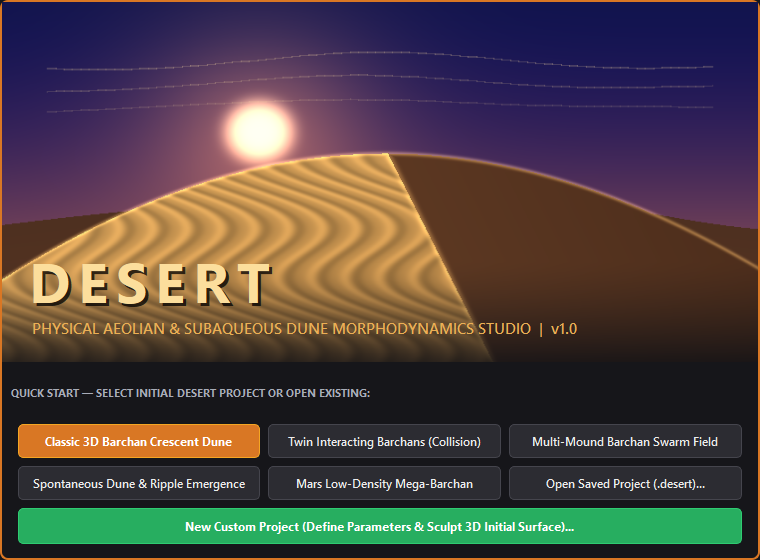
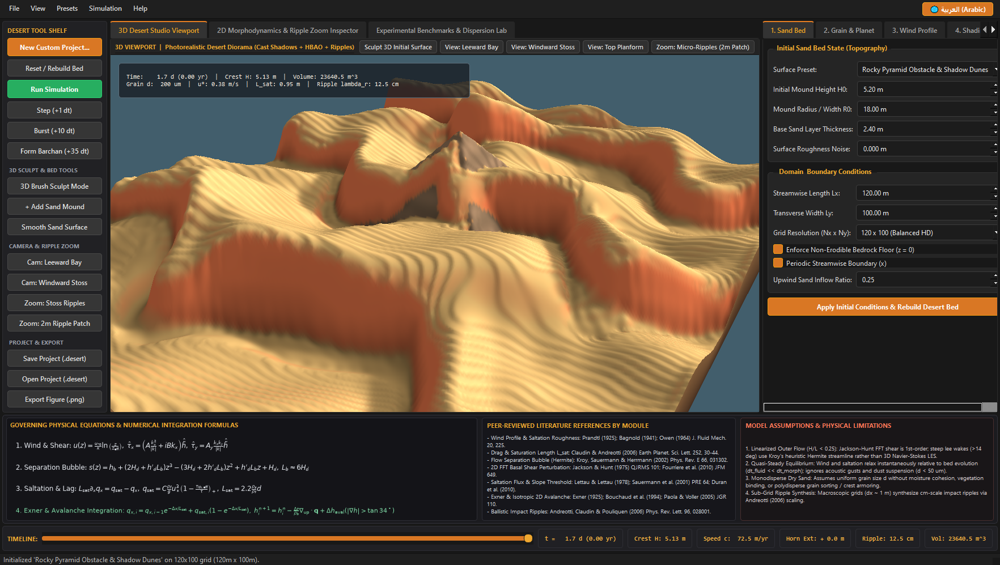
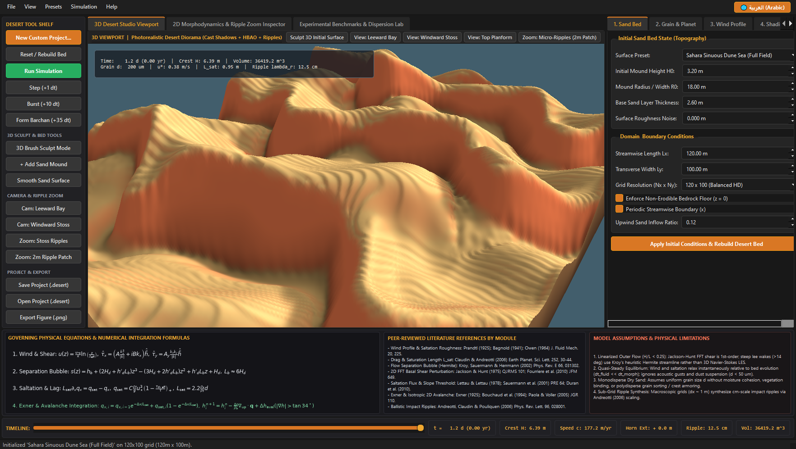
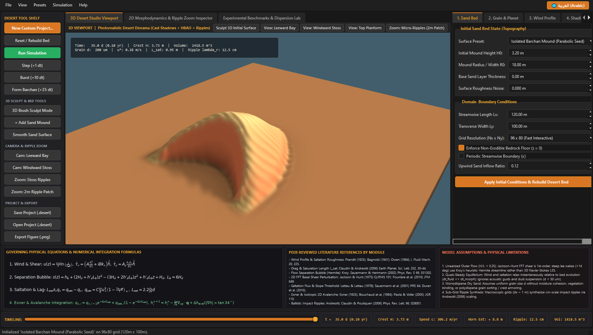
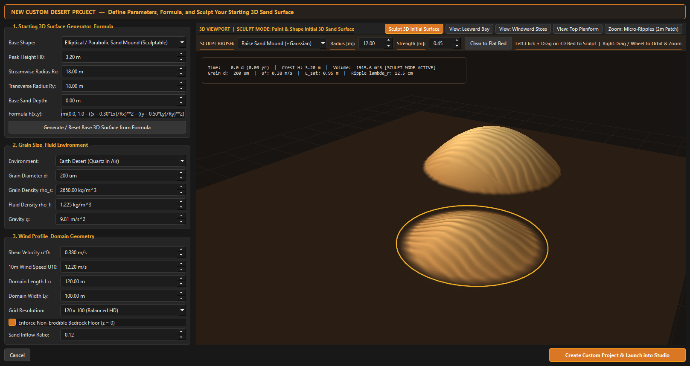
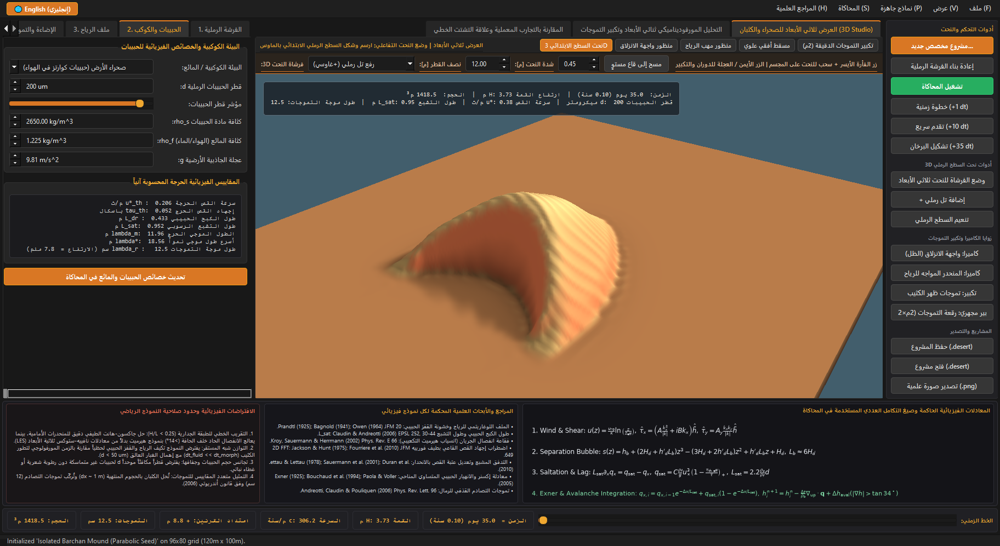
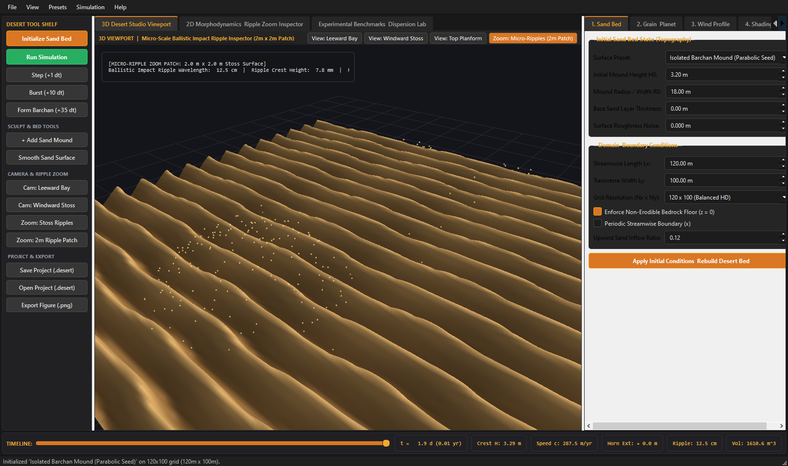
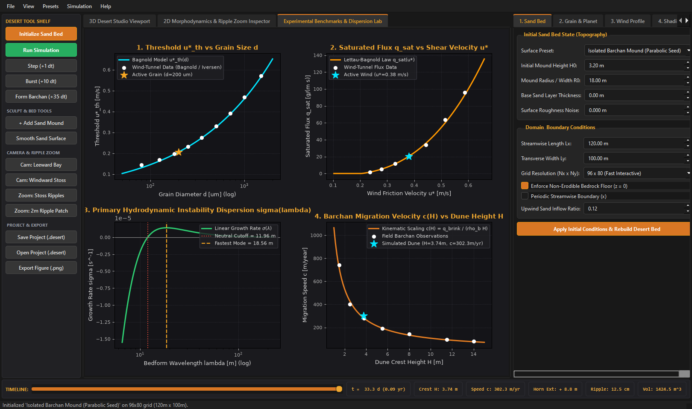

# Desert Dunes Simulations (`DESERT` Studio)

**Physical Aeolian & Subaqueous Sand Dune Morphodynamics Simulator and Interactive 3D Studio**

<p align="center">
  
</p>

---

## 1. Introduction to the Desert Model

**Desert** is a physically grounded 1D, 2D, and 3D continuum sand dune and ripple morphodynamics simulator paired with a Blender-inspired interactive 3D studio (**`Desert.exe`**).

- **Built on Peer-Reviewed Physics for Educational & Research Prospects**: This model is built directly upon foundational and modern peer-reviewed papers in aeolian geomorphology, boundary-layer fluid mechanics, and granular physics—specifically **Bagnold (1941)**, **Owen (1964)**, **Jackson & Hunt (1975)**, **Kroy, Sauermann & Herrmann (2002)**, **Claudin & Andreotti (2006)**, **Andreotti, Claudin & Pouliquen (2006)**, **Fourrière, Claudin & Andreotti (2010)**, and **Durán, Parteli & Herrmann (2010)**. It is designed as an interactive **educational and scientific laboratory** for students, educators, geologists, and physicists to explore how wind, sand grain size, and topography interact to sculpt desert landscapes across Earth, Mars, Venus, and subaqueous flumes.
- **Engineered to Run on Any PC**: By combining fast 2D Fast Fourier Transform (`FFT`) spectral boundary-layer solvers, unconditionally positive Exponential Euler spatial integration, and vectorized OpenGL 3D heightfield ray-marching, **Desert** runs smoothly in real time on any standard laptop or desktop PC—without requiring a supercomputer or external CFD cluster. It includes both a zero-configuration standalone Windows executable (**`Desert.exe`**) and a cross-platform Python package.
- **Bilingual Interface (`English / العربية`)**: Includes a one-click top-bar toggle between **English** and **Technical Arabic (`العربية`)** with rigorous academic terminology across all menus, parameters, equations, and reference manuals.

---

## 2. Physical Models, Governing Equations & Numerical Integration

At every morphological time step $\Delta t$, the simulator executes a six-stage physical pipeline. Every morphological feature—crescentic Barchan horns, $32^\circ$ avalanche slipfaces, leeward separation wakes, and centimeter-scale wind ripples—emerges from these coupled equations rather than ad-hoc geometric rules.

### Model 1: Turbulent Logarithmic Wind Profile & Saltation Roughness
- **Papers**: Prandtl (1925) *ZAMM* 5; Bagnold (1941) *The Physics of Blown Sand and Desert Dunes*; Owen (1964) *J. Fluid Mech.* 20, 225–242.
- **Physics**: Inside the turbulent atmospheric surface layer, wind velocity $u(z)$ follows the logarithmic Law of the Wall. When the friction velocity $u_{*0}$ exceeds the grain entrainment threshold $u_{*\mathrm{th}}$, saltating sand grains extract momentum from the air, increasing the effective roughness length $z_{\mathrm{eff}}$ via Owen's saltation roughness $z_{0,\mathrm{salt}}$:

$$u(z) = \frac{u_{*0}}{\kappa} \ln\!\left(\frac{z}{z_{0,\mathrm{grain}} + z_{0,\mathrm{salt}}}
ight), \qquad z_{0,\mathrm{grain}} = \frac{d}{30}, \qquad z_{0,\mathrm{salt}} = C_{\mathrm{Owen}} \frac{u_{*0}^2 - u_{*\mathrm{th}}^2}{2g}$$

where $\kappa = 0.40$ is the von Kármán constant, $d$ is the mean grain diameter, and $\tau_0 = 
ho_f u_{*0}^2$ is the undisturbed basal shear stress.

### Model 2: Grain Inertial Drag Length, Saturation Length & Threshold Scaling
- **Papers**: Iversen & White (1982) *Sedimentology* 29, 111–119; Claudin & Andreotti (2006) *Earth Planet. Sci. Lett.* 252, 30–44.
- **Physics**: A grain of density $
ho_s$ accelerated by a fluid of density $
ho_f$ requires an inertial drag length $L_{\mathrm{drag}}$ to reach the fluid velocity. Multi-grain splash cascades set the **flux saturation length** $L_{\mathrm{sat}}$, which governs the minimum unstable dune wavelength $\lambda_{\min} = 4\pi L_{\mathrm{sat}}$ and fastest-growing wavelength $\lambda_{\max} \approx 19.8 L_{\mathrm{sat}}$ across planetary environments:

$$L_{\mathrm{drag}} = \frac{
ho_s}{
ho_f}\,d, \qquad L_{\mathrm{sat}} = 2.2\,\frac{
ho_s}{
ho_f}\,d, \qquad u_{*\mathrm{th}} = A_B \sqrt{\frac{
ho_s - 
ho_f}{
ho_f}\,g\,d}, \qquad \tau_{\mathrm{th},0} = 
ho_f u_{*\mathrm{th}}^2$$

### Model 3: Flow Separation Bubble & Cubic Hermite Streamline Envelope
- **Papers**: Kroy, Sauermann & Herrmann (2002) *Phys. Rev. E* 66, 031302; Durán, Parteli & Herrmann (2010) *Earth Surf. Process. Landforms* 35, 1591–1600.
- **Physics**: Where the leeward slope steepens past the critical detachment angle $\theta_{\mathrm{sep}} \approx 14^\circ$ ($\partial_x h < -\tan 14^\circ \approx -0.2493$), the boundary layer detaches from the brink $(x_d, H_d)$. A cubic Hermite dividing streamline $s(z)$ bridges the recirculating wake eddy to the reattachment point at distance $L_b \approx 6 H_d$:

$$s(z) = h_{\mathrm{base}} + (2H_d + h'_d L_b)z^3 - (3H_d + 2h'_d L_b)z^2 + h'_d L_b z + H_d, \qquad z = \frac{x - x_d}{L_b} \in [0, 1]$$

$$L_b = \frac{1.5\,H_d}{\bar{s}'}\left(1 + \frac{1}{4}\nu + \frac{1}{8}\nu^2
ight), \qquad \nu = \frac{h'_d}{\bar{s}'}, \qquad \tilde{h}(x,y) = \max\!\big(h(x,y),\, s(x,y)\big)$$

Inside the separation bubble ($s > h$), basal shear stress is set to $\tau = 0$, trapping all saltating sand crossing the brink.

### Model 4: 2D Jackson–Hunt Spectral Basal Shear Stress Solver
- **Papers**: Jackson & Hunt (1975) *Q. J. R. Meteorol. Soc.* 101, 929–955; Hunt, Leibovich & Richards (1988) *QJRMS* 114; Fourrière, Claudin & Andreotti (2010) *J. Fluid Mech.* 649, 287–328.
- **Physics**: Computed in 2D Fourier space over the smooth aerodynamic envelope $\tilde{h}(x, y)$. The in-phase term $A k_x^2 / |\mathbf{k}|$ captures Bernoulli streamline compression over the crest, while the quadrature term $+i B k_x$ shifts the maximum shear stress **upwind of the topographic crest**—the primary hydrodynamic instability that amplifies sand dunes:

$$\hat{\tau}_{\mathrm{pert}, x}(k_x, k_y) = \left(A \frac{k_x^2}{\sqrt{k_x^2 + k_y^2}} + i\,B\,k_x
ight)\hat{\tilde{h}}(k_x, k_y), \qquad \hat{\tau}_{\mathrm{pert}, y}(k_x, k_y) = A_y \frac{k_x k_y}{\sqrt{k_x^2 + k_y^2}}\hat{\tilde{h}}(k_x, k_y)$$

$$\tau_x(x,y) = \tau_0\big(1 + \tau_{\mathrm{pert},x}(x,y)\big)\,(1 - \mathbb{I}_{\mathrm{wake}}), \qquad \tau_y(x,y) = \tau_0\,\tau_{\mathrm{pert},y}(x,y)\,(1 - \mathbb{I}_{\mathrm{wake}})$$

### Model 5: Non-Local Saltation Flux Relaxation & Slope-Modulated Threshold
- **Papers**: Lettau & Lettau (1978); Iversen & Rasmussen (1994) *Sedimentology* 41; Sauermann, Kroy & Herrmann (2001) *Phys. Rev. E* 64, 031305.
- **Physics**: Saltation flux $q_x(x,y)$ relaxes spatially toward the local saturated capacity $q_{\mathrm{sat}}(\tau)$ over the saturation length $L_{\mathrm{sat}}$, with a gravitational bed-slope modification $\tau_{\mathrm{th,eff}}$ that prevents unphysical windward over-steepening:

$$L_{\mathrm{sat}}\frac{\partial q_x}{\partial x} = q_{\mathrm{sat}}(\tau) - q_x, \qquad q_{\mathrm{sat}}(\tau) = C_{\mathrm{flux}}\frac{
ho_f}{g}u_*^3\left(1 - \frac{\tau_{\mathrm{th,eff}}}{\tau}
ight)_+, \qquad \tau_{\mathrm{th,eff}} = \tau_{\mathrm{th},0}\left(1 + \frac{\partial_x h}{\tan\theta_{\mathrm{rep}}}
ight)$$

- **Exact Exponential Euler Numerical Integration (`core/transport.py`)**: To guarantee unconditional positivity even when $L_{\mathrm{sat}} \ll \Delta x$, the linear ODE is integrated analytically across each grid cell $\Delta x$ with a finite-volume bedrock entrainment cap:

$$\mu = \exp\!\left(-\frac{\Delta x}{L_{\mathrm{sat}}}
ight), \qquad q_{x, i} = \min\!\left(q_{x, i-1}\,\mu + q_{\mathrm{sat}, i}(1 - \mu),\; q_{x, i-1} + \frac{
ho_{\mathrm{bulk}}\Delta x}{\Delta t}(h_i - h_{\mathrm{floor}})_+
ight)$$

### Model 6: Upwind Exner Mass Conservation, Isotropic 2D Avalanche & Ballistic Ripples
- **Papers**: Exner (1925); Bouchaud et al. (1994) *J. Phys. I* 4; Paola & Voller (2005) *JGR* 110; Andreotti, Claudin & Pouliquen (2006) *Phys. Rev. Lett.* 96, 028001.
- **Upwind Finite-Volume Exner Integration (`core/exner.py`)**:

$$h_{i,j}^{n+1,*} = h_{i,j}^n - \frac{\Delta t}{
ho_{\mathrm{bulk}}}\left(\frac{q_{x,i,j} - q_{x,i-1,j}}{\Delta x} + \frac{q_{y,i,j+1/2} - q_{y,i,j-1/2}}{\Delta y}
ight), \qquad \Delta t = \mathrm{clip}\!\left(\frac{\mathrm{CFL}\,\Delta x\tan 32^\circ}{\max|\partial_t h|},\, \Delta t_{\min},\, \Delta t_{\max}
ight)$$

- **Isotropic 2D Euclidean Avalanche Relaxation (`core/avalanche.py`)**: Slopes exceeding the static angle of repose ($\theta_{\mathrm{stat}} = 34^\circ$) relax isotropically to the dynamic angle of repose ($\theta_{\mathrm{dyn}} = 32^\circ$) using the full 2D Euclidean gradient norm $|\nabla h|_e = \sqrt{(\partial_x h)^2 + (\partial_y h)^2}$.
- **Multi-Scale Ballistic Impact Ripples (`core/wind_profile.py`)**: Superimposed cm-scale wind ripples follow the Andreotti–Bagnold scaling $\lambda_r = C_r\,d\sqrt{
ho_s/
ho_f}(u_*/u_{*\mathrm{th}})$, refracting orthogonally to local basal shear stress on active stoss and horn surfaces.

### Model Limitations & Validity Bounds
1. **First-Order Linearized Outer Flow ($H/L \lesssim 0.25$)**: The Jackson–Hunt spectral wind solver is a first-order boundary-layer expansion; steep lee wakes ($>14^\circ$) use Kroy's cubic Hermite separation bubble closure rather than 3D Navier–Stokes (LES) vortex shedding.
2. **Quasi-Steady Equilibrium ($\Delta t_{\mathrm{fluid}} \ll \Delta t_{\mathrm{morph}}$)**: Wind shear and saltation relax diagnostically at each morphological time step, neglecting second-scale gust transients and suspended dust plumes ($d < 50\,\mu\text{m}$).
3. **Monodisperse Cohesionless Dry Sand**: Assumes a single effective grain diameter $d$ without moisture capillary bridges, vegetation root stabilization, or polydisperse grain sorting.

---

## 3. Simulation Results & Visual Examples

### Example A: Rocky Pyramid Obstacle & Shadow Dunes (`desert_gui_pyramid_obstacle.png`)
Simulation of wind-driven sand dunes interacting with a non-erodible rocky pyramid obstacle (`bedrock_floor > 0`), demonstrating windward abrasion, lateral sand deflection, and leeward shadow dune formation:



### Example B: Sahara Sinuous Dune Sea & Classic 3D Barchan Crescent Diorama
Real-time 3D OpenGL diorama rendering with two-tone golden-stoss / coral-terracotta slipface coloring, ray-marched cast sun shadows, multi-scale heightfield ambient occlusion (HBAO), and geological cutaway walls:

| Sahara Sinuous Dune Sea (Full Field) | Classic 3D Barchan Crescent Diorama |
| :---: | :---: |
|  |  |

### Example C: Interactive 3D Initial Surface Sculptor & Bilingual Technical Arabic (`العربية`) Mode
Users can define custom mathematical formulas $h(x, y)$, sculpt the starting 3D sand surface directly with a 3D mouse brush, zoom into a $2\text{ m} \times 2\text{ m}$ micro-ripple patch, and toggle the entire studio between **English** and **Technical Arabic (`العربية`)**:

| Interactive 3D Initial Surface Sculptor | Technical Arabic (`العربية`) Studio Mode |
| :---: | :---: |
|  |  |

| $2\text{ m} \times 2\text{ m}$ Micro-Ripple Zoom Inspector | Experimental Benchmarks & Dispersion Lab |
| :---: | :---: |
|  |  |

---

## 4. How to Install from Git & Run on Any PC

### Step 1: Clone the Repository
```bash
git clone https://github.com/SidiElvalli/Desert-Dunes-simulations.git
cd Desert-Dunes-simulations
```

### Step 2: Run the Application (Two Options)

#### Option A: Instant Launch on Windows (`Desert.exe` — No Python Setup Required)
Simply double-click **`Desert.exe`** in the repository root, or run from PowerShell / Command Prompt:
```powershell
.\Desert.exe
```

#### Option B: Run from Python Source on Any PC (Windows, macOS, or Linux)
Requires **Python 3.10+**. Using [`uv`](https://github.com/astral-sh/uv) (or standard `pip` / `venv`):

**Using `uv` (Recommended):**
```bash
cd dune_simulator\nuv sync\nuv run python desert_app.py
```

**Using standard `pip` and `venv`:**
```bash
cd dune_simulator
python -m venv .venv
# On Windows:
.venv\Scripts\activate
# On macOS / Linux:
source .venv/bin/activate

pip install -e .
python desert_app.py
```

### Step 3: Run the Educational Scripts & Scientific Test Suite
```bash
cd dune_simulator

# Run all 36 unit and physical benchmark tests:
pytest tests -v

# Run standalone publication figure generators:
python examples/01_spontaneous_dune_formation.py --headless
python examples/02_gaussian_heap_evolution.py --headless
python examples/03_step_topography_response.py --headless
python examples/04_barchan_2d_simulation.py --headless
python examples/05_planetary_comparison.py --headless

# Regenerate the 7-page Physics Models & Equations Guide PDF:
python generate_physics_pdf.py
```

---

## 5. Contributors & Credits

- **SidiElvalli (Ahmed Kerim Vally)** — *Project Creator, Lead Researcher & Principal Developer* ([@SidiElvalli](https://github.com/SidiElvalli))
- **Gemini (Google AI)** — *Co-Developer, Continuum Physics Numerical Architect & 3D OpenGL Studio Engineer*
